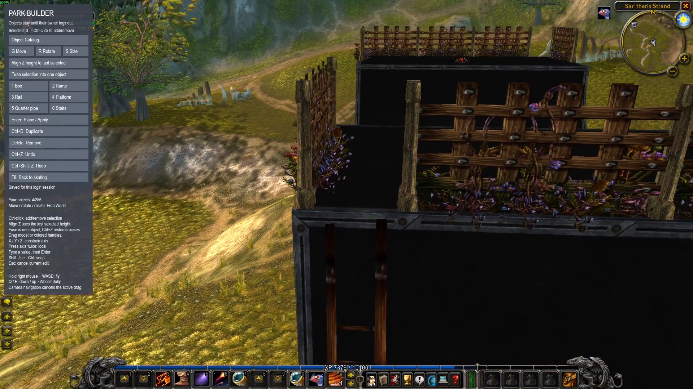
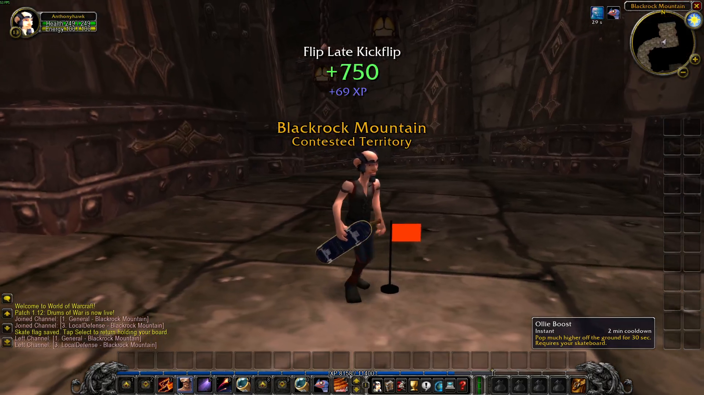
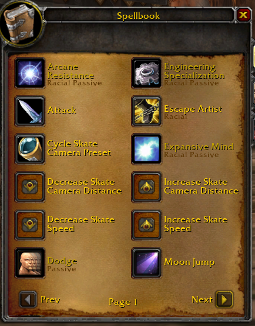

# World of Skatecraft — Skatebuilder

This fork adds a shared Skatepark Builder, persistent personal return flags, six new abilities,
and speed, physics, camera and controller improvements to
[Kimmo3223's World of Skatecraft](https://github.com/Kimmo3223/world-of-skatecraft).

**Mod source and showcase documentation only.** Everyone supplies their own WoW and Skate 3
copies. Game files, extracted/converted assets, databases, credentials and binaries are excluded.

## Skatepark Builder

> **Developed and tested on Windows.** This fork has not been validated on Linux or other
> operating systems and may require platform-specific setup or code changes. The original
> project supports Linux, but this fork's additions and Windows setup have separate requirements.

[](docs/media/skatebuilder.mp4?raw=true)

*Click the preview to open or download the full builder video.*

- Open the editor with **F8** or the **Park Builder** ability. Place ramps, quarter pipes, rails,
  platforms, boxes and stairs, or pick a model from the **Object Catalog**.
- Search names, aliases, model paths and asset IDs. Filter by **WoW / Skate / procedural**, choose
  a category, and sort by relevance, name or dimensions. A textured, rotatable preview lets you
  inspect an object before placing it. The catalog is generated locally from your own game files.
- Move, rotate and resize using draggable handles or **G / R / S**. Restrict a transform with
  **X / Y / Z**, type exact values, and place objects inside existing scenery.
- **Ctrl-click** selects multiple objects. **Align Z** matches their height to the last selected
  object. **Fuse** makes one movable assembly; adjoining pieces receive welded collision joins
  and internal-face cleanup so tiny ramp lips and quarter-pipe seams behave smoothly.
- Duplicate, delete, undo and redo placements and group edits. Hold right mouse to navigate with
  **WASD**, **Q / E** and **Shift** while keeping the selection and avoiding transform shortcuts.
- Builder objects are shared with other connected players. They stay when you close the editor
  and are removed when their owner logs out or disconnects, including objects on other maps.

## Personal respawn flag

[](docs/media/respawn-flag.mp4?raw=true)

*Click the preview to open or download the full flag video.*

In **Skate mode**, hold **Select / Back** (**Create** on PS5) for **0.7 seconds** to place your
private flag. Tap and release the same button to return to it. Return restores the saved facing
and puts you **off the board, holding it**, so you can stand at the top of a ramp without rolling
away; Triangle gets you back on the board.

The flag is visible only to you and is saved per character on the server through logouts,
logins and server restarts. Switching to WoW mode hides it and disables both flag actions while
keeping its placement. Same-map, same-instance, same-zone returns have no loading cover;
cross-map transfers use the ordinary loading transition. Friends see the resulting player
movement through the server. [Flag behavior and protocol details](docs/skate-flags.md).

## New abilities



Every character learns these abilities automatically at creation. Existing characters learn
missing abilities at login. Find them in the **General** spellbook tab and drag them onto your
action bar; the adjustment abilities work on or off the board and have no global cooldown.

| Added ability | What it does |
|---|---|
| **Park Builder** | Opens or closes the shared object editor. |
| **Increase Skate Speed ↑** | Adds **0.5x** to your selected speed and push power. |
| **Decrease Skate Speed ↓** | Removes **0.5x**, with a minimum of **0.5x**. |
| **Increase Skate Camera Distance ↑** | Adds **0.5x** to the engine camera distance. |
| **Decrease Skate Camera Distance ↓** | Removes **0.5x**, with a minimum of **0.5x**. |
| **Cycle Skate Camera Preset** | Cycles the engine's native **High / Low** camera presets. |

Speed and distance controls use the up/down arrow icons. Speed, distance and preset preferences
are saved per character on the server. Each press prints the current setting in chat; speed
messages also show the effective Speed Demon multiplier and the push-speed limit in mph/km/h.

## Other changes from the original

- **Faster default skating:** the selected speed starts at **1.5x**. **Speed Demon** multiplies
  the selected setting by **1.6x**, so the default with the buff is **2.4x**. Speed Demon and
  Rocket Boost print the current speed when used. All skate abilities, including the original
  boosts, are automatically learned rather than unlocked through skill progression.
- **A slightly floatier jump:** normal skate gravity is **0.9x**, and normal ollie pop is
  **1.1x**. Ollie Boost and Moon Jump retain their separate stronger effects.
- **Adjustable engine camera:** the Windows launcher starts in engine-camera mode. The patched
  server's default distance is **4.0x**, with **High** as the initial preset; **K** switches between
  WoW and Skate cameras. Distance keeps the engine's camera height/framing rather than lifting
  the view above the skater.
- **Camera collision and stability:** a swept camera volume checks terrain, buildings and
  builder objects, retracts immediately on collision, and eases outward when clear. High-speed
  filtering and the final post-shake collision pass reduce camera wobble and ground clipping.
- **Controller responsiveness:** independent **4 ms** input sampling, bounded input/worker
  queues, stale-input expiry, fixed-period simulation and disconnect/reconnect resets prevent
  software work from building into a growing input delay.
- **Source-reproducible setup:** native-engine and server modifications ship as text patches.
  Windows setup builds the patched server locally; asset converters generate the catalog and
  previews from the player's own files. Addon-corpus tests use platform-specific directory links
  so they compile on Windows as well as Unix. Formatting checks cover the mod workspace without
  traversing the downloaded external engine. A Git push guard and GitHub Actions audit enforce the
  [publishing policy](docs/source-only.md).
- **Fresh-server installs:** no running database, characters, accounts, login credentials or
  saved player state are included. Setup initializes a new server database and asks you to
  create your own account; the mod creates its empty preference and flag tables as needed.
- **Multiplayer foundation:** shared builder objects and server-authorized flag returns are
  implemented. The complete trick/bone-pose replication work has a
  [plan](docs/skate-multiplayer-plan.md) and [protocol foundation](docs/skate-network-protocol.md);
  full remote trick animation is still work to finish. Bail thresholds and bail adjustment
  buttons have not been changed.

## Original project and setup

Skate 3 skateboarding in World of Warcraft 1.12.1. Summon your skateboard like a mount and your
character drops onto it, with Skate 3's own physics: flick-it tricks, grinds on any ledge,
powerslides and bails, anywhere in Azeroth. Your own character does the tricks, in your own gear.
Skateboarding is a profession: land tricks to level it, earn experience and unlock skate abilities
such as Rocket Boost and Moon Jump.

This is [73igg's fork](https://github.com/73igg/world-of-skatecraft-skatebuilder) of
[Kimmo3223's World of Skatecraft](https://github.com/Kimmo3223/world-of-skatecraft), with the
shared Park Builder, searchable object catalog, speed and camera controls, controller input
improvements, camera collision fixes, and persistent personal return flags.

Built on [benilla](https://github.com/samwhosung/benilla), a from-scratch WoW 1.12.1 client in
Rust, and the [Skate 3 Rust Engine](https://github.com/SK8-ENGINE/skate-3-rust-engine). It runs
fully offline against a local server.

> **Unofficial fan project.** Not affiliated with Blizzard Entertainment or Electronic Arts.
> **Mod source and documentation only. No game files or game assets are included.** Everyone supplies their own
> copies of both games. WoW and Skate models, textures, audio, maps, extracted/converted assets,
> local databases, credentials, and compiled binaries must never be committed or uploaded.
> See [the source-only publishing policy](docs/source-only.md).

> **Vibe coded, just for laughs.** This whole thing was put together with an AI coding assistant
> (Claude Code) for fun, on top of other people's serious work (see Credits). Expect rough edges,
> weird bugs and a skater who doesn't always know where his sword goes. Don't take it seriously.

## What you need

- **Linux**, or **Windows (experimental)**. The current mod is developed and tested on Windows.
- **World of Warcraft 1.12.1**, English client (build 5875).
- **Skate 3 for Xbox 360, extracted**: the folder with `default.xex` and `data/` (an ISO file
  doesn't work; extract it first).
- **An Xbox-style controller.**
- **Docker**, about **20 GB** free disk, and a few hours once for the server's map extraction
  (plus a few minutes to build the server with the Skateboarding profession).

## Install

Linux:

```sh
git clone https://github.com/73igg/world-of-skatecraft-skatebuilder.git
cd world-of-skatecraft-skatebuilder
setup/setup.sh
```

Windows (experimental): install [Git](https://git-scm.com), then in a terminal:

```bat
git clone https://github.com/73igg/world-of-skatecraft-skatebuilder.git C:\skatecraft
cd C:\skatecraft
setup.bat
```

Setup checks your machine and tells you exactly what to install if something is missing, asks
for your WoW and Skate 3 folders, converts what it needs from them, sets up the local server,
creates your game account and builds the game. Step-by-step details: [INSTALL.md](INSTALL.md).

## Play

```sh
./play.sh        # Linux
play.bat         # Windows
```

Log in with the account you made during setup and create a character.

| Key | |
|---|---|
| **J** | summon / dismiss your skateboard |
| **K** | switch between the WoW camera and the Skate 3 camera |
| **F8** | enter / leave Park Builder |
| controller | skate (Skate 3 controls) |
| D-pad | skate abilities: ↑ Ollie Boost, → Rocket Boost, ← Speed Demon, ↓ Moon Jump |
| hold Select / Back (PS5 Create) | save your personal return flag in Skate mode |
| tap Select / Back (PS5 Create) | return to your flag, facing the saved direction and holding the board |

The flag is private and persists through logins and server restarts. Switching to WoW mode hides
it and disables its controls while keeping its saved placement. Same-map, same-instance,
same-zone returns do not show a loading cover. See [personal Skate flags](docs/skate-flags.md).

### Skateboarding, the profession

Every character knows **Summon Skateboard** (spellbook, General tab): it casts like a mount and
puts you on the board until you cancel the buff or press **J** again. Skateboarding is a
secondary skill, 1 to 300, in your Skills tab. Each line of tricks you land raises it (bigger
lines raise it faster) and gives your character experience; the line's score, the experience and
the skill it earned show at the top of the screen, Skate 3 style. Every character knows all skate
abilities from creation; existing characters learn any missing abilities at their next login.
Find them in the spellbook's General tab and drag them onto your action bar:

| Ability | Effect | Lasts | Cooldown |
|---|---|---|---|
| Summon Skateboard | ride | until cancelled | none |
| Increase Skate Speed ↑ | increase the selected speed and push power by 0.5x | saved per character | none |
| Decrease Skate Speed ↓ | decrease the selected speed and push power by 0.5x, down to 0.5x | saved per character | none |
| Increase Skate Camera Distance ↑ | move the engine camera farther away by 0.5x | saved per character | none |
| Decrease Skate Camera Distance ↓ | bring the engine camera closer by 0.5x, down to 0.5x | saved per character | none |
| Cycle Skate Camera Preset | switch between the engine's High and Low presets | saved per character | none |
| Park Builder | enter / leave the object editor | until closed | none |
| Ollie Boost | pop much higher | 30 s | 2 min |
| Rocket Boost | a burst forward | instant | 30 s |
| Speed Demon | multiply the selected speed and push power by 1.6x | 30 s | 3 min |
| Moon Jump | lighter gravity in the air | 20 s | 5 min |

The selected speed starts at 1.5x. The arrow abilities work on or off the board and have no global
cooldown. Each adjustment prints the selected multiplier, the effective multiplier including
Speed Demon, and the push-speed limit in mph and km/h in chat. Speed Demon and Rocket Boost also
print the current setting when cast. The other skate boosts require your skateboard.

Engine camera distance starts at 4.0x its original framing. Its arrow abilities work on or off
the board, have no global cooldown, and print the current distance in chat on every press.
Changes apply while riding and persist per character; the saved setting overrides the launch
distance. These controls adjust distance; **K** still switches camera modes.
The preset starts at High. Each press of Cycle Skate Camera Preset switches High to Low or Low
to High and prints the selection in chat. It uses the engine's native camera graphs and preserves
your selected distance.

The profession and speed abilities need the patched Skatecraft server. On another server **J**
just hops on and off the board.

Your account is a GM, so chat commands like `.tele stormwind`, `.levelup 59` and
`.additem <id>` work.

### Park Builder

Open it with **F8** or the automatically learned **Park Builder** ability. Choose a ramp,
quarter pipe, box, rail, platform or stairs. These are procedural practice pieces. Objects can
overlap existing scenery; every player sees and collides with the saved objects. Leaving the
editor keeps them in place. Logging out or disconnecting removes all objects owned by that
player, including objects left on other maps.

**Object Catalog** opens the library of WoW props/buildings and native Skate park pieces. Filter
by game and category, sort by name, relevance or dimensions, and search names, aliases, paths or
asset IDs. Search ignores case; multiple words narrow the results together, and quoted phrases
match consecutive words. Click a result or **Preview** to inspect its textured model, drag the
preview to rotate it, and use the mouse wheel to zoom. **Use this object** starts placement.
Imported objects support the same move, rotation, resize, alignment, fusion and undo controls.
Mixed WoW/Skate assemblies keep their constituent models and materials.

Hold **right mouse** to navigate with **WASD**, **Q/E** to move down/up, and **Shift** to move
faster. Camera navigation cancels an unfinished transform and keeps the selection. Use **G** to
move, **R** to rotate and **S** to resize; drag the colored handles or the selected model. **X/Y/Z**
restrict a transform to an axis; Z is vertical. Type a value and press **Enter** for precise
placement, or press **Esc** to cancel. Rotation values are degrees. The tool buttons provide the
same controls.

**Ctrl-click** toggles objects in the selection. **Align Z** matches their origin heights to the
last selected object. **Fuse** replaces the selected pieces with one assembly that can be moved,
rotated and resized together. Fusion welds hairline joins and removes internal collision faces;
align and fuse adjoining quarter pipes when building a half pipe. **Ctrl-Z** undoes alignment,
fusion and group transforms; **Ctrl-Y** or **Ctrl-Shift-Z** redoes them. **Ctrl-D** duplicates the
selection and **Delete** removes it.

## Help

This is a hobby project with **best-effort help only**. If something breaks:

1. Run the doctor (`setup/setup.sh --doctor`, or on Windows
   `powershell -ExecutionPolicy Bypass -File setup\setup.ps1 -Doctor`) and read
   [TROUBLESHOOTING.md](TROUBLESHOOTING.md).
2. Still stuck? Ask in [Discussions](../../discussions) (Q&A) and attach your `setup.log` and the
   doctor output. Questions without them may go unanswered.

**Windows testers:** whether it works or not, a post in Discussions with your Windows version,
GPU, controller and `setup.log` helps a lot.

## Credits

- **[benilla](https://github.com/samwhosung/benilla)** by samwhosung and contributors: the WoW
  1.12.1 client this is built on. Its own README is in [docs/BENILLA.md](docs/BENILLA.md).
- **[Skate 3 Rust Engine](https://github.com/SK8-ENGINE/skate-3-rust-engine)** by SK8-ENGINE /
  Chasm: the skateboarding, built on **dumbad**'s years of Skate 3 reverse engineering
  ([DumbadsSkate3ModdingTools](https://github.com/Ethanw05/DumbadsSkate3ModdingTools)).
- **[2010 Rust Rewrite Mashup](https://github.com/chasmlol/2010-rust-rewrite-mashup)** by chasmlol,
  on [IW4L](https://github.com/vladtrc/iw4L) by vladtrc: the Skate 3 mode for MW2 this one
  follows.
- **[vmangos](https://github.com/vmangos/core)** and
  **[vmangos-deploy](https://github.com/mserajnik/vmangos-deploy)** (mserajnik): the local server.
  **[vgmstream](https://vgmstream.org)**: decodes the Skate 3 sounds during setup.

## Legal

The code here is benilla's licence, MIT or Apache 2.0 at your option, except where a file says
otherwise; see [NOTICE](NOTICE). The skate engine is downloaded from its authors' repository at
build time and is not part of this repository. No World of Warcraft or Skate 3 content is
included or distributed: the game reads your WoW install, and setup converts your own Skate 3
files on your machine. World of Warcraft is a trademark of Blizzard Entertainment, Inc.; Skate is
a trademark of Electronic Arts Inc.
